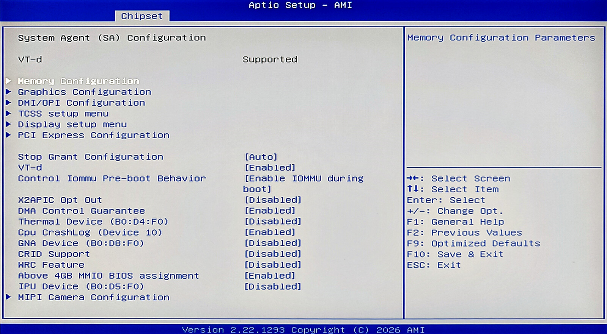
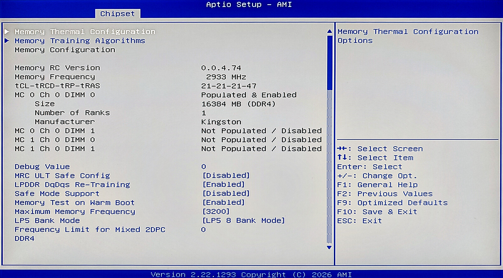
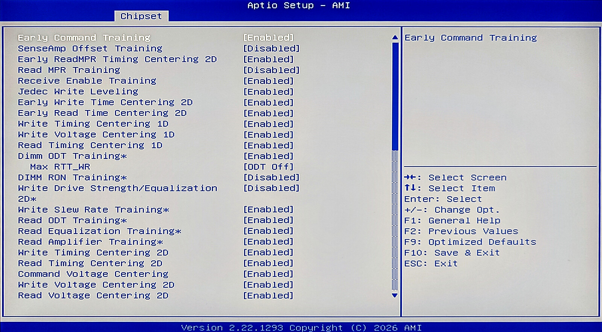
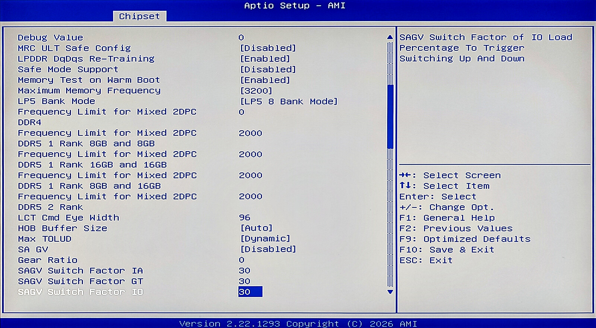

# GMKtec G3 Plus – unofficial modified BIOS with unlocked menus (and a 32 GB DDR4 workaround)

Two modified builds of the official GMKtec NucBox G3 Plus (Intel N150) AMI Aptio BIOS (`G3_Plus076`, 2026-01-12) that unlock the hidden BIOS menus and advanced BIOS settings, and the script that generates them.

Newly visible menus (~40 entries hidden by the stock BIOS, ~140 setup pages in total):

- **Chipset:** System Agent (SA) Configuration — Memory Configuration (max memory frequency, Safe Mode, MRC training algorithms, rank/channel control…), graphics, VT-d / IOMMU, Above 4G MMIO, PCIe — and PCIe LAN configuration.
- **CPU:** VR settings, Power Limit 3, custom P-state table, turbo ratio limits, CPU lock configuration, P-core/E-core information.
- **Advanced:** Thermal, Platform Settings, PCI Subsystem, CSM, BCLK, ACPI (RC ACPI, D3Cold), SIO / serial console redirection, SMART, PCH-FW (ME), connectivity, debug.
- **PCH-IO:** HD Audio, FIVR, PMC, security, thermal throttling, SerialIo / ISH / THC / SCS, PCIe clocks and EQ.

| BIOS image | Changed factory defaults | For |
|---|---|---|
| `bios/G3_Plus076_20260112_unlocked.bin` | Hidden setup menus visible | Anyone who wants the full setup (Chipset › System Agent › Memory Configuration, Thermal, CPU VR, …) |
| `bios/G3_Plus076_20260112_unlocked_2933.bin` | Same + **Maximum Memory Frequency = 2933** | 32 GB dual-rank SO-DIMMs that don't POST at 3200 |

**2933 version:** some 32 GB DDR4-3200 SO-DIMMs won't boot on the G3 Plus — black screen, no display, fan spinning, keyboard not lighting up. Lowering the memory speed to 2933 MT/s fixed it in my case (Kingston KP6FH5-MIE).

Only factory-default *data* is changed (3 and 9 bytes), no code, so the settings survive **Load Defaults (F9)** and a CMOS clear.

> ⚠️ **Flashing a BIOS can brick your machine**; a failed flash is only recoverable with an external SPI programmer. Tested on one unit. Use at your own risk.

**Unofficial, not affiliated with or endorsed by GMKtec.**

## Screenshots

Examples of the unlocked setup pages:

| | |
|---|---|
|  |  |
| Chipset › System Agent (SA) Configuration | Memory Configuration |
|  |  |
| Memory Training Algorithms | Memory Configuration (continued) |

## Compatibility

**Only** the official package `G3_Plus_10W_SODIMM_20260112200632` (`G3_Plus076`, 2026-01-12); its `bios.bin` hash is in [`SHA256SUMS`](SHA256SUMS). The script refuses any other image.

My unit shipped with BIOS `G3_Plus076` dated **2024-11-06** (AMI 5.27). The 2026-01-12 build keeps the same version string and the same memory-training code, so updating alone doesn't fix 32 GB modules.

## Flashing

The flashing tools (Intel `Fpt.efi` + GMKtec's UEFI shell) aren't included, they come with the official package.

1. **Download** the official `G3_Plus_10W_SODIMM_20260112200632` from [GMKtec's BIOS folder](https://drive.google.com/drive/folders/1y9z5q7_VEDcMsA3cGTf5SpTqgAMwJ3Xp).
2. **Format a USB pendrive as FAT32 with the label `WINPE`.**
3. **Copy the package to the pendrive's root folder**:
   ```
   efi (folder)
   bios.bin
   Fpt.efi
   Startup.nsh
   ```
   As is, this flashes the official BIOS.
4. **Optional – use a modified image:** copy it over `bios.bin` on the pendrive (the name must stay `bios.bin`) and check `sha256sum bios.bin` against `SHA256SUMS`.
5. **Flash:** with a module that POSTs and no other USB storage plugged in, boot the pendrive (F7), and it powers off when done. Then remove the pendrive and boot normally.

After flashing, all settings and UEFI boot entries are gone:

- *"Boot Option Restoration"* reboot loop → pick your OS loader once from the SSD's entries in the boot menu.
- Re-apply settings, e.g. **Advanced › Wake on Power → S0 State** (default stays off after an outage) and **C states → Enabled** (off by default).

## Why (and test results)

My G3 Plus didn't POST at all with a 32 GB **Kingston KP6FH5-MIE** (DDR4-3200, 2Rx8): fan on, no video, keyboard never lit up. The previous 16 GB **Kingston 9905700-122.A00G** module was fine. Others report the same with the Kingston KCP432SD8/32, while the Crucial CT32G4SFD832A works (Intel's official max for the N150 is 16 GB). The official BIOS hides the memory settings, so a lower speed couldn't be tried. Unlocked:

| Max Memory Frequency | Kingston KP6FH5-MIE, cold boots |
|---|---|
| Auto / 3200 (also with DDR4_1DPC off, Safe Mode) | No POST |
| **2933** | **Boots every time, memtest86+ clean** |

With the plain unlocked image, F9 resets the frequency to Auto and that module stops POSTing again — hence the `_2933` image.

## Performance: 2933 vs 3200

How much does 2933 cost? Measured with the stock **16 GB Kingston 9905700-122.A00G** (DDR4-3200, single rank) at 2933 vs 3200 MT/s (same session, idle host, best/average of 3 runs).

| Synthetic | 2933 | 3200 | Difference |
|---|---|---|---|
| STREAM Copy, 1 process | 19.2 GB/s | 20.7 GB/s | +7.5 % |
| STREAM Triad, 1 process | 14.7 GB/s | 15.9 GB/s | +8.2 % |
| STREAM Copy, 2 / 4 processes | 9.1 / 10.9 GB/s | 9.0 / 11.3 GB/s | ~0 / +4 % |
| Random read latency, 64 MB (tinymembench) | 125.2 ns | 119.7 ns | −4.4 % |

| Real world | 2933 | 3200 | Difference |
|---|---|---|---|
| `xz -T4`, 400 MB in RAM | 76.45 s | 75.63 s | +1.1 % |
| 7-Zip 24.09 benchmark, 4 threads | 10726 MIPS | 10747 MIPS | +0.2 % |
| 7-Zip 24.09 benchmark, 1 thread | 4969 MIPS | 5034 MIPS | +1.3 % |
| GCC `-O2` build of SQLite 3.46.1 | 31.57 s | 31.36 s | +0.7 % |
| SQLite in-memory workload (Python) | 7.25 s | 7.16 s | +1.2 % |
| Jellyfin QSV 4K HDR → 1080p tone-mapped, 1 stream | 65 fps | 68 fps | +4.1 % |
| Jellyfin QSV, 2 simultaneous streams | 36 + 36 fps | 38 + 38 fps | +5.6 % |

CPU workloads gain only ~1 %. The single memory channel, not the frequency, is the bottleneck once several cores compete. The iGPU (Quick Sync transcoding) is the most memory-sensitive real workload, at ~4–6 %. The 32 GB dual-rank Kingston at 2933 performed the same as this module at 2933.

## What is changed

Default values in the three uncompressed AMI `StdDefaults` copies (no checksums there, no Boot Guard):

| Variable | Offset | Official | Unlocked | Unlocked 2933 |
|---|---|---|---|---|
| `Setup` (hidden-menu flag) | 0x2F | 0 | 1 | 1 |
| `SaSetup` (Maximum Memory Frequency, MT/s, u16) | 0x18B | 0 (Auto) | 0 | 2933 |

## Building

Follow these instructions to patch the official image yourself. You can audit the script:

```sh
python3 patch_defaults.py official/bios.bin G3_Plus076_20260112_unlocked.bin
python3 patch_defaults.py official/bios.bin G3_Plus076_20260112_unlocked_2933.bin --max-mem-freq 2933
```

The script verifies the input hash and every byte it changes. Analysis done with [UEFITool/UEFIExtract](https://github.com/LongSoft/UEFITool) and [IFRExtractor-RS](https://github.com/LongSoft/IFRExtractor-RS).

## License

Script and docs: public domain ([The Unlicense](LICENSE)). The BIOS images are derived from GMKtec's official BIOS and remain their owners' property; provided as-is, without warranty.
